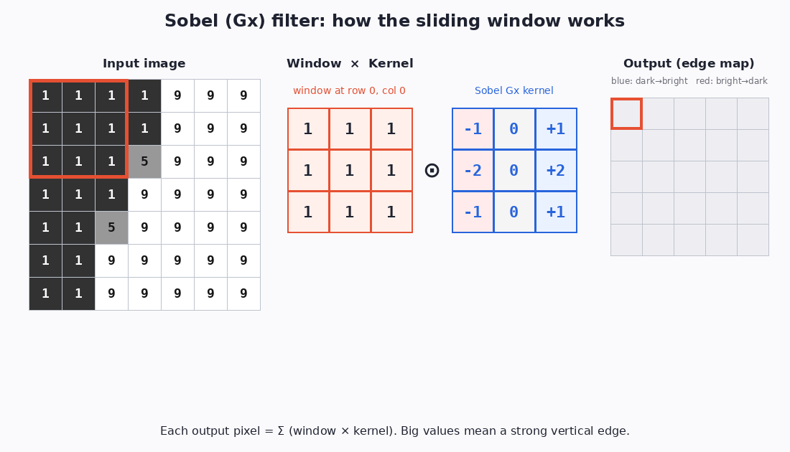

# ASCIIArtGenerator

Transforms text or pictures into graphics made of keyboard letters, numbers and symbols.

A C# Windows desktop application featuring an optimized assembly (MASM) backend library for high-performance image processing and edge detection.


## Table of contents

- [Features](#features)
- [Getting started](#getting-started)
- [Usage](#usage)
- [Architecture & How it works](#architecture--how-it-works)
  - [Edge detection with the Sobel filter](#edge-detection-with-the-sobel-filter)
- [Project structure](#project-structure)
- [License](#license)

## Features

- Convert **text** into ASCII art.
- Convert **pictures** into ASCII art built from letters, numbers and symbols.
- High-performance **MASM assembly core** handling compute-intensive convolution and edge detection filters.
- Native C# Windows desktop user interface.

## Getting started

### Requirements

- Windows 10/11
- [.NET SDK](https://dotnet.microsoft.com/) (latest recommended version)

### Build

```text
1. Clone the repository
   git clone https://github.com/AveePB/ASCIIArtGenerator.git
```

## Usage

1. Start the application.
2. Enter text or load a picture (`.png`, `.jpg`, etc.).
3. Fine-tune generation settings (such as character density and edge-detection weighting).
4. Generate the ASCII art and copy or save the result to a text file.

## Architecture & How it works

The application is structured into two main layers:
1. **Presentation & Logic Layer (C#):** Handles user interaction, file I/O, image loading, UI rendering, and mapping pixel intensities to ASCII character sets.
2. **Performance Layer (MASM):** Provides low-level vectorized calculations for heavy image processing algorithms (like filtering and edge detection).

An ASCII art generator maps image intensity to characters: dark areas get "dense" characters (such as `@` or `#`) and bright areas get "light" ones (such as `.` or a space). Picking characters by brightness alone gives a good overall likeness, and **edge detection** can be used to make outlines and fine detail stand out.

### Edge detection with the Sobel filter

The Sobel filter is a classic edge detector. It slides a small 3×3 window across the image and, at every position, multiplies the pixels under the window by a 3×3 kernel, element by element, and adds up the nine products. 



The animation shows the horizontal-gradient kernel **Gx**, which responds to vertical edges:

```text
        | -1   0  +1 |
Gx  =   | -2   0  +2 |
        | -1   0  +1 |
```

For each window position:

1. Take the 3×3 block of pixels under the window.
2. Multiply it element-wise with the kernel.
3. Sum the nine products. The sum is the output pixel.

A worked example from the animation, with the window sitting on the edge (dark pixels on the left, bright on the right):

```text
window        kernel        products
1  1  9       -1  0  1      -1   0   9
1  1  9   ⊙   -2  0  2   =  -2   0  18       sum = 8 + 16 + 8 = 32
1  5  9       -1  0  1      -1   0   9
```

- On a flat region the left and right columns cancel out, so the result is **0**.
- On an edge they do not cancel, so the result is **large**.

The kernel for horizontal edges, **Gy**, is the transpose of Gx. The two can be combined into one edge strength:

```text
G = sqrt(Gx² + Gy²)
```

> **Note:** The animation is an explainer for the technique. The application processes these calculations via optimized assembly routines.

## Project structure

```text
ASCIIArtGenerator/
├── DesktopApplication/   # C# Windows desktop application source code
├── AssemblyCore/         # MASM assembly library for image filtering
├── docs/
│   └── sobel_filter.gif  # animation used in this README
├── LICENSE
└── README.md
```

## License

Distributed under the MIT License. See [`LICENSE`](LICENSE) for details.